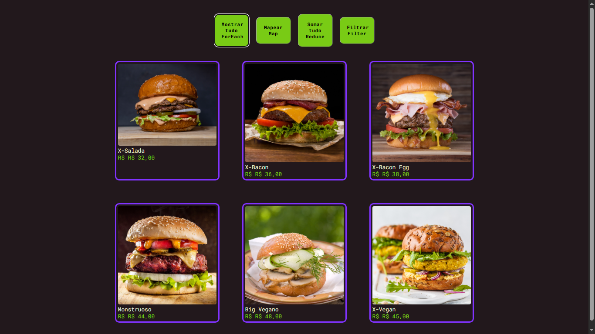
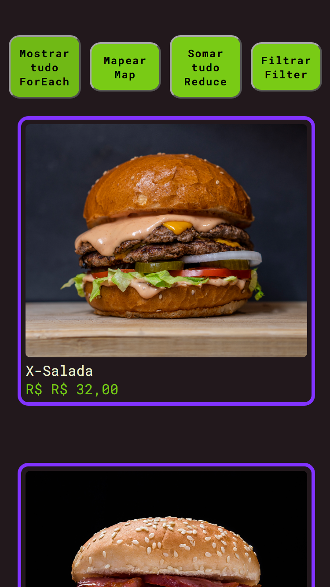

<h1>:computer: Site de portfólio feito em aula, Hamburgueria:wink:</h1>

<h2>Neste projeto mentoriado em aula no <a href="https://www.devclub.com.br" target="_blank">DevClub</a> mas com pequenas coisas minhas 
ampliamos nosso conhecimento nas ferramentas de For Each, Map, Reduce e Filter :grin:</h2>

<h3><b>Abaixo podemos ver o projeto em Pc's e Smartphones :point_down::open_mouth:</b></h3>

<h2>Computadores/Computers :computer:</h2>
<figure>
  
  <figurecaption>Img-hamburgueria-pc</figurecaption>
</figure>
 
 

<h2>Celulares/Smartphones :iphone:</h2>
<figure>
  
  <figurecaption>img-hamburgueria-smartphones</figurecaption>
</figure>

<h1>:open_mouth:TECNOLOGIAS UTILIZADAS :sunglasses:</h1>
 
<ul>
  <li>HTML</li>
  <li>CSS</li>
  <li>JAVASCRIPT</li>
</ul>
 
:white_check_mark:
